  

  

  
  
  

  

### `01 //` ✈️ Flagship System — VAA Share

> **Dark Cockpit Aero-Tech HUD** · Full-stack academic resource sharing platform built for Vietnam Aviation Academy.

<table>
  <tr>
    <td width="160"><b>Layer</b></td>
    <td><b>Architecture &amp; Choices</b></td>
  </tr>
  <tr>
    <td><code>FRONTEND</code></td>
    <td>React 19 + Vite + React Router · Hand-rolled CSS design system (WCAG 2.2 AA)</td>
  </tr>
  <tr>
    <td><code>BACKEND</code></td>
    <td>Node.js 22 + Express (MVC: controllers, routes, role middleware, rate limiting)</td>
  </tr>
  <tr>
    <td><code>DATABASE</code></td>
    <td>MySQL 8 / MariaDB (<code>utf8mb4</code>) · 8 normalized tables via <code>database/vaa_share.sql</code></td>
  </tr>
  <tr>
    <td><code>SECURITY</code></td>
    <td>JWT + Bcrypt (10 rounds) · Multer uploads (JPG/PNG/WEBP, 5 MB cap) · CSP headers</td>
  </tr>
  <tr>
    <td><code>DEPLOY</code></td>
    <td>Vercel (SPA fallback + reverse proxy) · Signed commits (SSH/GPG) on <code>main</code></td>
  </tr>
</table>

🔒 Core repository is private — happy to walk through the architecture or grant access on request.

  

### `02 //` 🛰️ Selected Systems &amp; Open-Source Lab

<table>
  <tr>
    <td width="50%" valign="top">
      <a href="https://github.com/toilanguyen2910/promptfilm"><b>🎬 promptfilm</b></a> 
      One sentence in, a researched 3D motion graphic out — Claude Code skill generating looping real-time Three.js HTML films &amp; frame-exact MP4s.
    </td>
    <td width="50%" valign="top">
      <a href="https://github.com/toilanguyen2910/betaker"><b>🛡️ betaker</b></a> 
      AI-powered security code auditor &amp; automated patching CLI tool engineered in Python.
    </td>
  </tr>
  <tr>
    <td width="50%" valign="top">
      <a href="https://github.com/toilanguyen2910/auto-sniper-app"><b>⚡ auto-sniper-app</b></a> 
      High-speed multi-task web auto-sniper with FastAPI backend, real-time WebSocket HUD, encrypted storage, and Playwright engine.
    </td>
    <td width="50%" valign="top">
      <a href="https://github.com/toilanguyen2910/lucian-ai-chat-exporter"><b>🧩 lucian-ai-chat-exporter</b></a> 
      One-click AI chat handoff &amp; full-fidelity export (PDF, Markdown, Word, HWPX) for ChatGPT, Claude, Gemini &amp; Grok (Chrome MV3).
    </td>
  </tr>
  <tr>
    <td width="50%" valign="top">
      <a href="https://github.com/toilanguyen2910/game-dev-studio"><b>🎮 game-dev-studio</b></a> 
      Game development toolkit for AI coding agents: 10 skills, 10 agent roles, 7 templates, and a runnable Godot example.
    </td>
    <td width="50%" valign="top">
      <a href="https://github.com/toilanguyen2910/toeic-lr-practice"><b>🎧 toeic-lr-practice</b></a> 
      React 19 + TypeScript TOEIC L&amp;R trainer with 10–990 scoring, 195 unit tests &amp; 78 Chrome CDP integration tests.
    </td>
  </tr>
</table>

  

### `03 //` 🧰 Tech Arsenal &amp; AI Agents

  <b>LANGUAGES</b> 
  
  
  
  
  

  <b>FRAMEWORKS &amp; INFRASTRUCTURE</b> 
  
  
  
  
  
  
  
  
  

  <b>AI AGENTS &amp; VERIFICATION</b> 
  
  
  
  
  

  

### `04 //` 📡 Comms &amp; Uplinks

  
  
  
  

  

